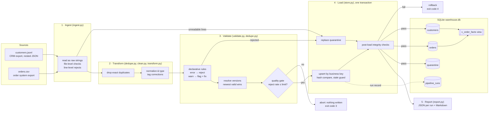

# Architecture

A single-process batch pipeline in five stages. Each stage is a separate module with a narrow contract,
so each can be tested on its own and replaced without touching the others.



Customers are processed before orders because order validation needs the set of valid customer ids
(from this run **and** from earlier runs already in the database) and their signup dates.

## Stages and contracts

| # | Stage | Module | Input → Output | Failure behaviour |
|---|---|---|---|---|
| 1 | Ingest | `ingest.py` | file → DataFrame of raw strings + list of unreadable lines | Missing / empty / non-UTF-8 file, missing required column, or required JSON field absent from *every* record → `IngestionError`, run stops (exit 2). A single bad line → recorded as a reject, file continues. |
| 2 | Transform | `dedupe.py`, `clean.py`, `transform.py` | raw strings → typed columns, `<field>__raw` kept, `_corrections` tags | Never raises on bad values: unparseable values become NULL and validation decides. |
| 3 | Validate | `validate.py`, `dedupe.py` | typed frame → accepted (with `dq_flags`) + rejected (with `reasons`); then one row per key | Rule violations are data, not exceptions. Reject rate above the configured limit → `DataQualityError` before any write (exit 3). |
| 4 | Load | `store.py` | records → upserts, quarantine, integrity checks, in one transaction | Any exception or failed check → `ROLLBACK`; the database is exactly as before the run (exit 4 or 1). |
| 5 | Report | `report.py` | run stats → `reports/runs/<run_id>.json`, `reports/latest.json`, `reports/data_quality_report.md` | Runs in `finally`, so failed runs are reported too. |

`runner.py` orchestrates the stages and owns run-level concerns: run id, timings, record-count
reconciliation, the quality gate, the transaction boundary and the `pipeline_runs` record. `cli.py` is a
thin wrapper that maps exceptions to exit codes.

## Why the raw / clean separation matters

Ingestion keeps every value as the exact string that arrived (`keep_default_na`-style coercion is never
applied, so `"N/A"` stays `"N/A"` and `"007"` stays `"007"`). All interpretation happens in one place,
`transform.py`, which keeps the raw value next to the parsed one. That is what lets validation emit
`unit_price_missing` vs `unit_price_invalid`, and lets the quarantine table store the record exactly as
received, so it can be replayed after a fix.

## Data model

```
customers (customer_id PK)  1 ──< orders (order_id PK, customer_id FK)
quarantine (entity, fingerprint PK)        pipeline_runs (run_id PK)
```

| Table | Key | Notes |
|---|---|---|
| `customers` | `customer_id` (business key) | `country_code` ISO-2, `signup_date` ISO date, `dq_flags` lists warning rules |
| `orders` | `order_id` (business key) | Money in **integer cents** (`unit_price_cents`, `total_cents`); `CHECK` constraints on quantity, price, currency length; `FOREIGN KEY` to customers |
| `quarantine` | `(entity, sha256(raw record))` | Raw record, source file and line, every failing rule. Reflects the latest run. |
| `pipeline_runs` | `run_id` | Status (`running` → `success`/`failed`/`dry_run`), input file hashes, full statistics JSON, error text |
| `v_order_facts` | view | Orders joined to customers with amounts in currency units, for analysts |

Every data row also carries `row_hash` (SHA-256 of its business columns), `first_loaded_run_id` and
`last_changed_run_id`, which give lineage ("which run wrote this value?") for free.

## Run lifecycle

1. Insert `pipeline_runs` row with status `running` (committed immediately, so a crash leaves evidence).
2. Ingest → transform → validate both entities in memory; reconcile counts.
3. Quality gate.
4. `BEGIN IMMEDIATE` (takes the write lock up front, so two concurrent runs serialize instead of interleaving)
   → upsert customers → upsert orders → replace quarantine → integrity checks → `COMMIT`.
5. Update `pipeline_runs` with final status and statistics; write reports.
